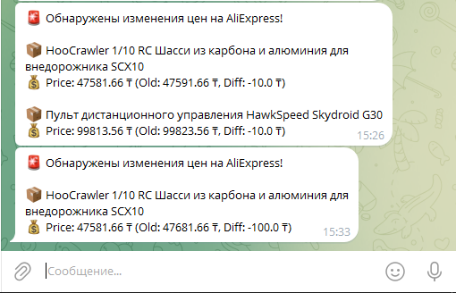
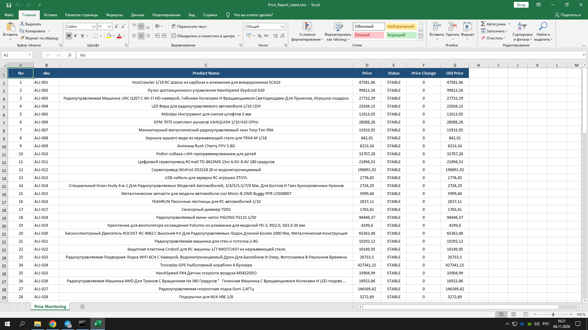
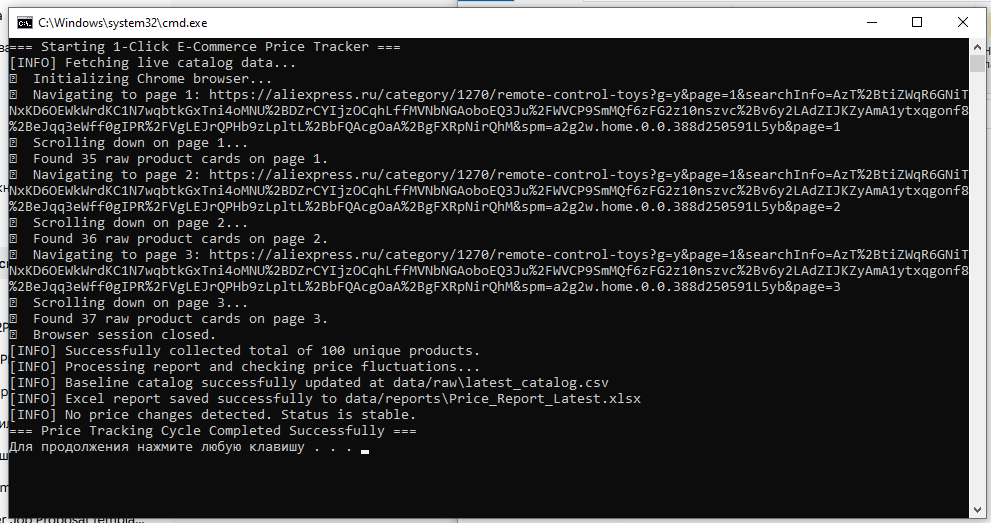

# 🛒 E-Commerce Automated Price Tracker

A robust, production-ready Python automation tool designed to scrape localized product catalogs, track price fluctuations over time, generate professionally styled Excel reports, and dispatch instant Telegram alerts in Russian.

Built with clean architecture, cross-platform compatibility, and automated background execution capabilities — tailored for e-commerce monitoring and freelance portfolio presentation.

---

## 📸 Project Showcase

| Telegram Alerts (RU) | Professional Excel Report | Console Execution |
| :---: | :---: | :---: |
| [cite: 1] | [cite: 2] | [cite: 3] |

---

## 🚀 Key Features

* **Advanced Web Scraping (`Selenium` + `BeautifulSoup`):** Reliable multi-page catalog extraction with automated minimized browser mode, anti-bot / captcha handling checkpoints, and duplicate filtering.
* **Smart Data Analytics (`Pandas`):** Compares data snapshots to detect accurate price changes (`PRICE DROP`, `PRICE INCREASE`, `NEW PRODUCT`, `REMOVED`, `UNCHANGED`).
* **Professional Excel Reporting (`openpyxl`):** Automatically generates styled reports featuring custom header fills, gridline visibility, thin borders, automatic column width adjustments, and conditional cell alignments.
* **Localized Telegram Notifications (`Requests`):** Dispatches concise, formatted alerts in Russian for any price shifts with correct currency tracking and message-chunking to prevent API overflow[cite: 1].
* **Cross-Platform & Automation Ready:** Out-of-the-box launchers for both **Windows (`run.bat`)** and **macOS/Linux (`run.sh`)** with automated dependency checks and silent background execution.

---

## 🛠️ Tech Stack

* **Language:** Python 3.10+
* **Data Processing:** pandas, numpy
* **Web Scraping:** selenium, beautifulsoup4
* **Reporting:** openpyxl
* **API & Automation:** requests, Windows Task Scheduler / Cron

---

## 📁 Project Structure

```text
price_tracker/
│
├── assets/
│   └── images/               # Screenshots for documentation
├── data/
│   ├── raw/                  # Persistent baseline state (.csv)
│   └── reports/              # Generated styled Excel reports (.xlsx)
│
├── src/
│   ├── main.py               # Main orchestration script & console minimizer
│   ├── scraper.py            # AliExpress scraper module
│   ├── analyzer.py           # Price delta & snapshot comparison engine
│   ├── reporter.py           # Excel styling & report generator
│   └── notifier.py           # Telegram bot notification sender
│
├── .env.example              # Template for environment variables
├── requirements.txt          # Project dependencies
├── run.bat                   # Quick launcher for Windows
└── run.sh                    # Quick launcher for macOS / Linux
